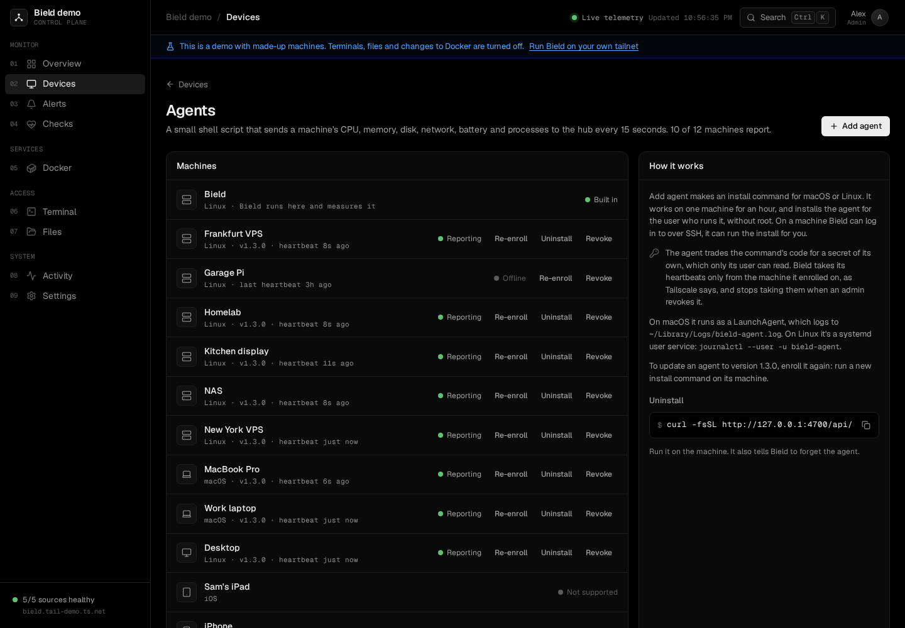

# The agent

Tailscale tells Bield which machines exist, whether they're online, and how traffic reaches them. It says nothing about what a machine is doing. For that, a machine either runs Bield, or runs the agent.

The agent is one bash script, [`agent/agent.sh`](../agent/agent.sh), that sends a heartbeat to Bield every 15 seconds. It needs only `curl` and the tools every Linux or macOS system has, and it runs on macOS's bash 3.2. It's licensed under the [MIT License](../agent/LICENSE), so you can reuse it.



## What you get

With an agent, a machine's page shows its CPU, memory, swap, disk, network traffic, temperature, battery, load, uptime and process count, with history charts from the last hour to 90 days, and a list of what uses the CPU and memory. Bield can raise [alerts](settings.md#alerts) about disk, memory, CPU and a stopped agent. Without one, a machine only shows what Tailscale knows.

Bield doesn't need an agent for the machine it runs on. On Linux it measures that machine itself, and the Agents page lists it as **Built in**. If Bield runs on a Mac, it can't measure that machine, so install the agent on it like any other.

## What it sends

A heartbeat holds the agent's version, the machine's host name, OS, OS version, kernel, model and architecture, the figures above, and the processes that use the most CPU and memory, grouped by program, with a shortened command line (on macOS, only the program's path). Viewers don't see the command lines. Bield caps a heartbeat at 256 KiB.

To see exactly what a machine would send, run the script with `--print`. It writes the heartbeat to the terminal and sends nothing:

```sh
SERVER_URL=http://127.0.0.1 SECRET=x bash agent.sh --print
```

The agent doesn't read file contents or the environment of the processes it lists. It runs nothing that Bield sends back, since all it looks at in Bield's answer is whether the heartbeat was accepted, and the error text if it wasn't.

## Installing it

Open **Devices**, then **Agents**, and press **Add agent**. Or open the machine's own page and press **Install the agent**. Either way, Bield makes an install command like this:

```sh
curl -fsSL https://bield.example.ts.net/api/agent/install/<code> | bash
```

Run it on the machine, as the user that should run the agent. It needs no root and no `sudo`. The code in it works on one machine, for an hour. The dialog waits and tells you when the machine reports.

If Bield has [SSH access](ssh.md) to the machine, the dialog you open from the machine's page, or from its row on the Agents page, also offers **Install over SSH**, which runs the same install there for you.

Bield writes the address into the command from the **Public URL** setting if you've set one, and otherwise uses its own address on the tailnet. The machine has to be able to reach that address, so it has to be on your tailnet and allowed to reach Bield. With a [tailnet policy](tailscale.md#tailnet-policy) that restricts traffic, allow it from the machines that run agents.

### What the installer does

1. Trades the code for a secret of the agent's own, by asking Bield, which also checks that the request comes from the machine the code is for.
2. Saves the script and the secret, with these paths on Linux and macOS:

   | | Linux | macOS |
   | --- | --- | --- |
   | The script | `~/.local/share/bield-agent/agent.sh` | `~/Library/Application Support/bield-agent/agent.sh` |
   | Its settings and secret | `~/.config/bield-agent/env`, readable only by you | the same |
   | How it runs | The systemd user service `bield-agent` | The LaunchAgent `dev.bield.agent` |
   | Its log | `journalctl --user -u bield-agent` | `~/Library/Logs/bield-agent.log` |

3. Sends a first heartbeat, and stops if that fails, with the reason.
4. Starts the service, which restarts the agent if it stops.

On Linux, a user service stops when the user logs out, unless lingering is on. The installer reminds you: `sudo loginctl enable-linger $USER`.

The agent reads `SERVER_URL`, `SECRET` and `INTERVAL` from its settings file. [The configuration reference](configuration.md#the-agent) lists them.

## The Agents page

| State | What it means |
| --- | --- |
| Built in | Bield runs here and measures the machine itself. |
| Not installed | The machine can run an agent, and has none. |
| Not supported | Bield has no agent for this operating system. Agents run on Linux and macOS, so phones, tablets and Windows machines show this. |
| Waiting for a heartbeat | The code was used, and nothing has arrived yet. |
| Reporting | Heartbeats arrive. |
| Stopped reporting | The machine is online, and no heartbeat has come for 90 seconds. The Agent stopped rule opens an alert. |
| Offline | The machine is off the tailnet. |
| Update available | The agent is an older version than the one Bield has. |
| Not enrolled | An agent from before enrollment existed. Bield no longer takes its heartbeats, so install it again. |

Each machine has three actions:

- **Re-enroll**, or **Update**, makes a new install command for it. Run that command on the machine, which replaces the script and the secret. This is also how you update an agent, since a new Bield carries a new script.
- **Uninstall** runs the uninstall for you over SSH on a machine Bield has [SSH access](ssh.md) to. For any other machine, the page shows the command to run there.
- **Revoke** makes Bield forget the machine's agent, and its secret stops working at once. Do this for a machine you've lost, or when its secret leaked. Bield burns the codes the machine used, so the old install command doesn't work again.

### Uninstalling

On the machine:

```sh
curl -fsSL https://bield.example.ts.net/api/agent/uninstall.sh | bash
```

It stops the service, tells Bield to forget the agent, and removes the script and its settings. If Bield can't be reached, it says so, and you revoke the agent on the Agents page.

## How Bield knows who is talking

An agent's heartbeat carries its secret, and Bield checks two things: the secret, and the machine it comes from. Bield asks Tailscale which machine each connection is from. It never believes an IP address or host name in the heartbeat. A secret copied to another machine is refused. Bield keeps only a hash of codes and secrets, so a copy of the database doesn't give anyone a secret.

An agent that gets a 401, 403 or 409 waits 5 minutes before it tries again, because Bield isn't going to change its mind soon. A machine that has only just joined the tailnet may get a 404 for up to ten seconds, until Bield's next look at the tailnet. The agent keeps trying.

Bield refuses an agent on a machine it measures itself, with a 409. If you run Bield on a Linux machine, don't install an agent there.

## When a machine doesn't report

- Run the installer again, and read what it prints. It says why a code fails: expired, used by another machine, or revoked.
- Check the machine can reach Bield: `curl -I https://bield.example.ts.net` from it.
- Read the log (see the table above).
- Run `bash ~/.local/share/bield-agent/agent.sh --once` on Linux. It sends one heartbeat and prints the result, which includes Bield's error message.
- Look at the [FAQ](faq.md).
