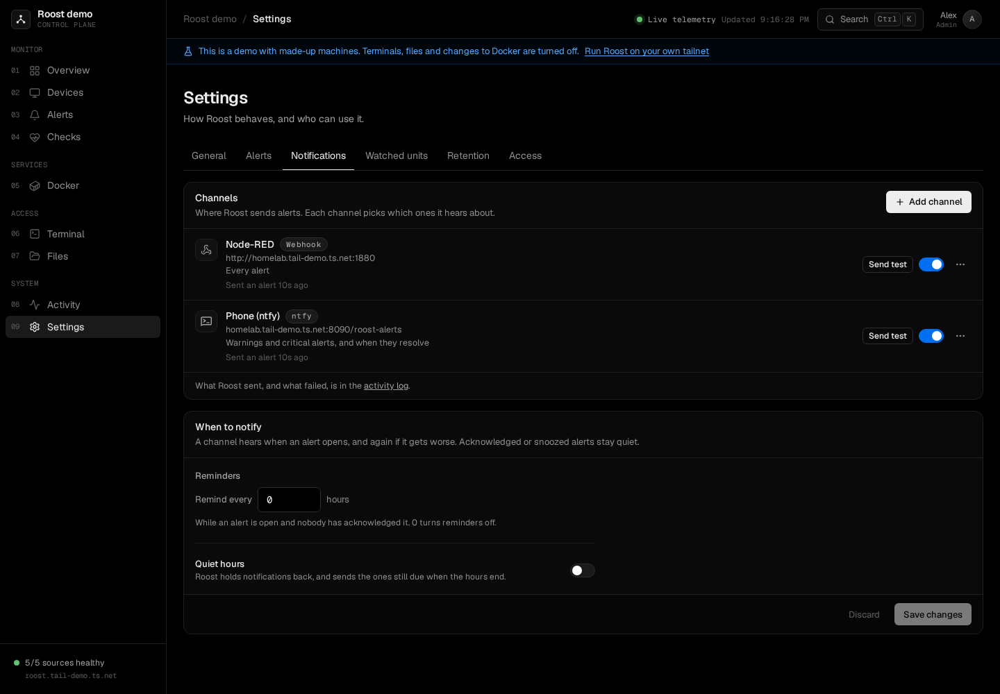

# Notifications

Roost can send a message to your phone, a chat room or an inbox when an alert opens. You set up the places, called channels, in **Settings, Notifications**. Only admins can see or change them.



## Channels

Add a channel, pick its kind and name it, then press **Send test** on its row. A name can be up to 40 characters, and Roost can have 20 channels.

| Kind | What you need | Notes |
| --- | --- | --- |
| ntfy | A topic. A server address if it isn't `https://ntfy.sh`. | On ntfy.sh, anyone who knows a topic can read it, so pick one that's hard to guess. For a topic that needs a login, add an access token, or a username and password. Messages about a critical alert have ntfy's highest priority, and about a warning the next one down. Everything else, including resolved alerts and tests, has the default. |
| Discord | A webhook URL | In Discord: channel settings, Integrations, Webhooks, New Webhook, Copy Webhook URL. |
| Slack | An incoming webhook URL | From an Incoming Webhooks app in your workspace. |
| Telegram | A bot token and a chat ID | Message `@BotFather` to make a bot, then send your bot a message so it may reply. The chat ID is a number, or `@name` for a public channel. |
| Email | An SMTP server, a from address, and up to 10 addresses to send to | The connection is STARTTLS (port 587), TLS (port 465) or none (port 25). Leave the port empty for the connection's usual one. Roost only signs in over a connection with no TLS if the mail server is on the same machine. |
| Webhook | An address, and maybe a bearer token | Roost posts JSON to it. See [the webhook's JSON](#the-webhooks-json). |

Webhook URLs, tokens and passwords are secrets. Roost keeps them in its database, which isn't encrypted, and never sends them back to the browser. When you edit a channel, a saved secret shows "Saved. Type to replace it.", and leaving the field alone keeps it. **Remove** clears an optional one. A [backup](upgrading.md#backing-up) includes them, so keep backups private. A channel's kind can't change. Add a new channel instead.

## What a channel hears

Each channel picks how much it hears about:

- **Every alert**, **Warnings and critical**, or **Only critical**. A new channel starts at warnings and critical.
- **Also when an alert resolves**, which a new channel has on.

A new channel is told about the alerts that are already open, if they fit its routing and nobody has acknowledged them. A channel you switch off hears nothing, and when you switch it back on it hears about the open alerts it missed.

## When Roost sends

For each channel and each alert, Roost sends a message when:

- the alert opens,
- it gets worse, such as a warning that turns critical, and the channel hasn't heard about the worse one,
- it's still open and nobody has acknowledged it, if reminders are on,
- it resolves, if the channel wants that.

An acknowledged or snoozed alert stays quiet. Roost checks every 5 seconds.

Two settings under **When to notify** apply to every channel:

- **Remind every N hours** repeats the message for an alert that's still open and not acknowledged. The time counts from the last message about it. It's 0, which sends no reminders, until you set it, and it can be up to 168 hours.
- **Quiet hours** holds messages back from the **From** time until the **Until** time, which can be on the other side of midnight, such as 22:00 to 07:00. The **Time zone** is your browser's when you turn quiet hours on, and the one Roost's machine is in if you empty it. Roost sends what is still due when the hours end, and an alert that opens and resolves inside them says nothing. **Still send critical alerts** is on by default.

If a message fails, Roost tries again after 30 seconds, then 2 minutes, then 10 minutes. After the fourth failure, it stops, writes one error line in the [activity log](pages.md#activity), and leaves the alert's next reminder as the next try. The log says why it failed, such as the status code the server answered, but never what was in the answer. **Send test** shows an admin the error, with some of what the server said.

Messages and failures show up in the activity log for viewers too, with the channel's name and the alert's title. There are no secrets in them.

## Links in messages

A message has a link to the alert, `/alerts?alert=<id>`, on the **Public URL** from [Settings, General](settings.md#general). Without one, it uses Roost's own address on the tailnet, and if Roost doesn't know that either, the message has no link.

## Where Roost sends from

Messages go out from the machine Roost runs on, through Roost's own tailnet connection. A tailnet name works in a webhook URL or an ntfy server address, so you can post to something on your tailnet. Roost doesn't follow redirects.

An admin can point a channel at any address, including the local network, since that's how you reach a self-hosted ntfy. Link-local addresses (`169.254.0.0/16` and `fe80::/10`, where cloud providers keep metadata services) and the well-known metadata names are refused. See [SECURITY.md](../SECURITY.md#files-docker-and-what-roost-reaches-out-to).

## The webhook's JSON

A webhook channel posts this to its address, with `Content-Type: application/json`, and `Authorization: Bearer <token>` if you gave it a token:

```json
{
  "event": "opened",
  "text": "Warning: Disk 90% full on NAS\n\n771 GB of 7.3 TB left on /.\n\nWarning, open for 3m\n\nhttps://roost.example.ts.net/alerts?alert=12",
  "severity": "warning",
  "title": "Disk 90% full on NAS",
  "detail": "771 GB of 7.3 TB left on /.",
  "alert": {
    "id": 12,
    "openedAt": "2026-11-01T20:57:00Z",
    "resolvedAt": null,
    "url": "https://roost.example.ts.net/alerts?alert=12"
  },
  "instance": "Roost",
  "at": "2026-11-01T21:00:00Z"
}
```

- `event` is `opened`, `escalated`, `reminder`, `resolved` or `test`.
- `severity` is `critical`, `warning` or `info`.
- `text` is the whole message in one string. Mattermost, Rocket.Chat and many other chat tools post a field with this name as the message, so their incoming webhooks work as they are.
- `alert` is missing from a test. `resolvedAt` is a time once the alert has resolved, and `url` is empty when Roost doesn't know its own address.
- `instance` is the name from Settings, General.
- Any 2xx answer counts as delivered.

## If nothing arrives

1. Press **Send test** on the channel. A failure says why.
2. Check the channel's routing. A channel set to **Only critical** doesn't hear about a warning.
3. Check quiet hours, and whether the alert is acknowledged or snoozed.
4. Check that the channel's switch on the **Notifications** tab is on. A paused channel has a Paused badge.
5. Look in the activity log, filtered to Notifications, for the error.
