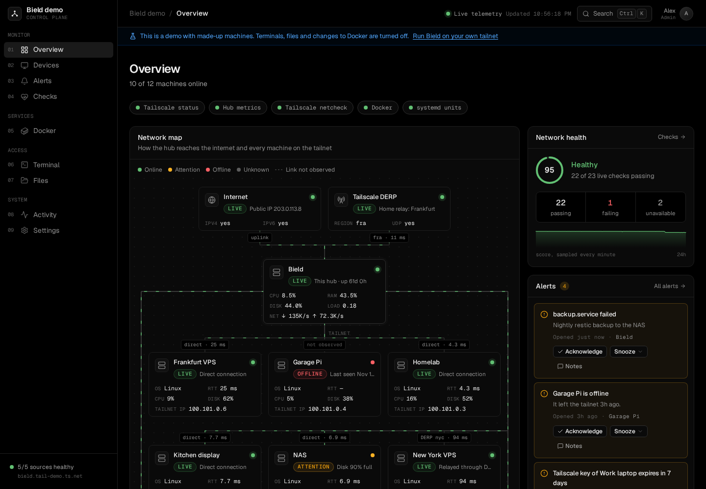
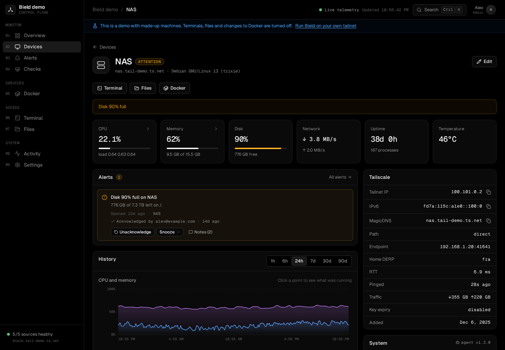
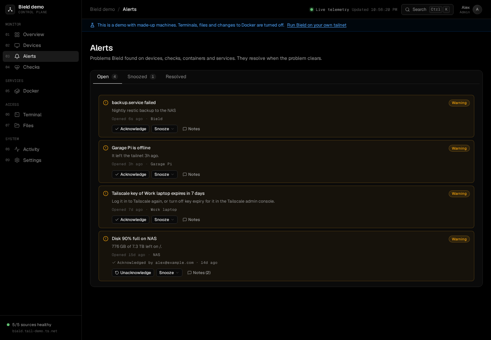
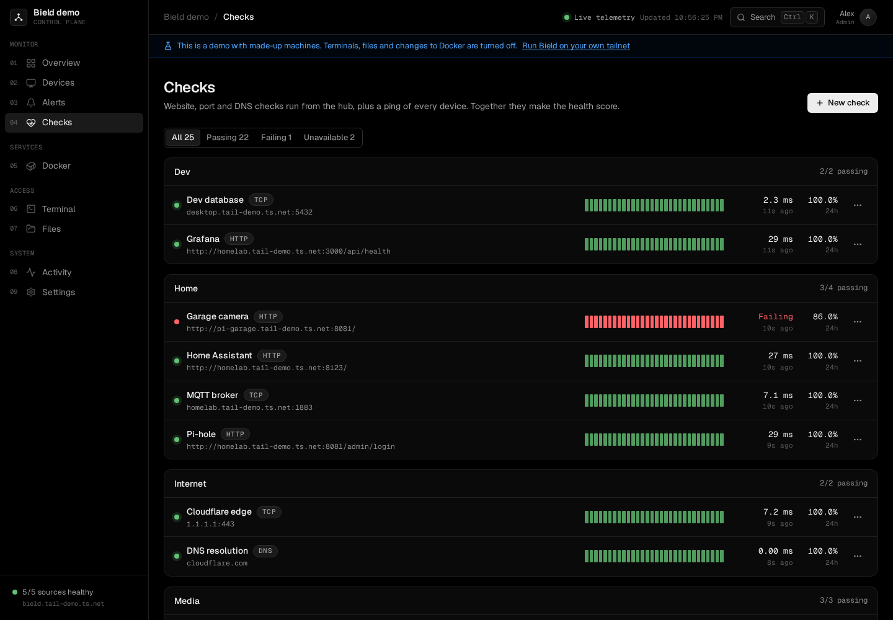
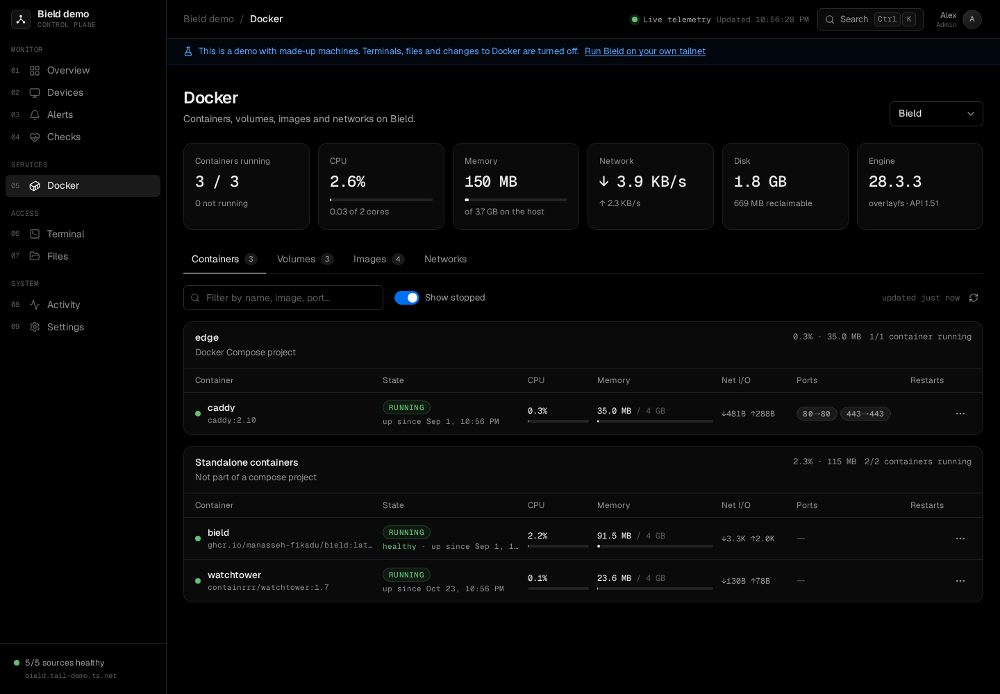
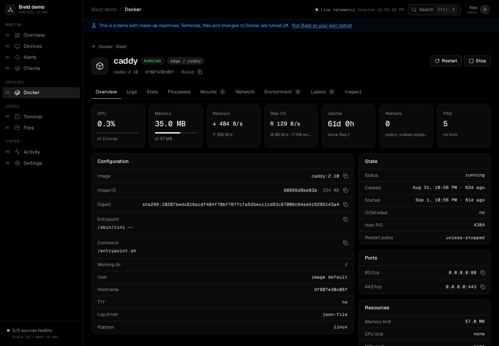
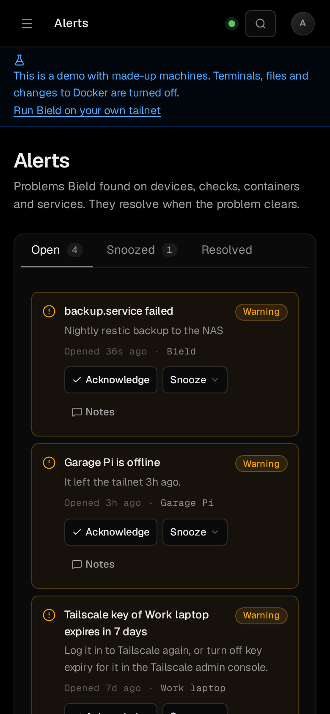

# A tour of Bield

The sidebar has nine pages, in this order. Press `g` and then a number to jump to one, `Ctrl+K` (`⌘K` on a Mac) to search pages, devices and actions, and `?` for every shortcut. Admins see all nine. Viewers don't see Terminal, Files or Settings, and [some fields are left out](#what-viewers-see) of the others.

You can look at all of this without installing anything: `bield serve --demo` runs a made-up tailnet ([Demo mode](demo.md)).

## Overview

How the tailnet is doing, at a glance. It shows how many machines are online, whether each of Bield's sources is healthy (Tailscale, the hub's own metrics, the network check, Docker, systemd), and a map: the internet and Tailscale's relay at the top, the hub in the middle, every machine below it, with the kind of path to each (direct, relay or peer relay) and its round-trip time. The **Network health** card is the health score from [Checks](#checks). Open alerts and a table of machines sit below.

The first time an admin opens Bield, the Overview sends them to the [first-run setup](#first-run-setup).

## Devices

A table of every machine on the tailnet with its status, how traffic reaches it (the connection), its tailnet IP, and, for machines that report, its CPU, memory and disk, and when it was last seen. Filter by status. **Agents** in the corner opens [the agent page](agent.md).

A machine's page has:

- Buttons for **Terminal**, **Files** and **Docker**, when Bield has [SSH access](ssh.md).
- Tiles for CPU, memory, disk, network and uptime, and one more for battery, temperature or swap, if it has an agent or Bield measures it.
- Its open alerts, which you can acknowledge or snooze there.
- **History**, with charts for 1 hour to 90 days: CPU and memory, network, disk, and the round-trip time. Click a point to see what was running then.
- What uses its CPU and memory right now, and the trend over days.
- Its **Tailscale** details: addresses, MagicDNS name, the path and endpoint, the home relay, the key's expiry, and how much traffic has passed.
- The **System** details the agent reports, a **Notes** card, and the cards for [SSH access](ssh.md) and the agent.

**Edit** changes the machine's name, its type, its thresholds and its notes. See [per-device thresholds](settings.md#per-device-thresholds).

## Alerts

Problems Bield found on devices, checks, containers and services. An alert opens when a rule's condition becomes true, and resolves a minute after it stops. The rules and their thresholds are in [Settings](settings.md#alerts).

The tabs are **Open**, **Snoozed** and **Resolved**. On an alert, an admin can:

- **Acknowledge** it, which says someone has seen it and stops notifications and reminders. **Unacknowledge** takes that back.
- **Snooze** it for 1 hour, 4 hours, 1 day or 1 week. It comes back when the time is up if the problem is still there.
- Add **Notes**, such as what you did. They stay with the alert after it resolves.

Each alert has its own link, `/alerts?alert=<id>`, which [notifications](notifications.md) use.

## Checks

Checks run from the hub, on a schedule. There are three kinds:

| Kind | What it does | Target |
| --- | --- | --- |
| HTTP | Makes a request, and passes if the status is the one you expect, or any status below 400. It doesn't follow redirects. **Skip TLS check** accepts a certificate of its own. | A URL |
| TCP | Opens a connection. | `host:port` |
| DNS | Looks the name up, with the hub's own resolver. | A name |

Each check has a name, a group, an interval (from 10 seconds to a day, 1 minute by default), and a timeout (from 200 ms up to a minute, 5 seconds by default, and shorter than the interval). The hub runs up to six checks at once. A check can be paused, and run on demand. A check's target is a name or address that the hub can reach, so use `127.0.0.1` for the hub's own machine, or a tailnet name for another. Bield keeps only the status line of an answer, never the body.

Every device on the tailnet also has a ping check, made by Bield, which fails when the device is online and doesn't answer pings. A new Bield has three checks in a group called Internet: TCP to `1.1.1.1:443`, a DNS lookup of `cloudflare.com`, and an HTTPS request to `https://www.google.com/generate_204`. They show whether the hub can get online. Delete them if you don't want Bield to make those requests.

The **health score** is the share of live checks that pass, rounded down. It's healthy from 90 and degraded from 70. The Overview shows it with its last day. A check that keeps failing opens an [alert](settings.md#alerts).

## Docker

The containers, volumes, images and networks of one machine, picked at the top. The machine Bield runs on works when it can use the Docker socket ([Docker on the same machine](install.md#docker-on-the-same-machine), [Docker](docker.md#managing-the-machines-containers)). Another machine needs [SSH access](ssh.md#docker-on-other-machines).

The summary tiles show running containers, CPU, memory, network and disk use, and the engine version. Containers are grouped by Compose project, with their state, CPU, memory, network, ports and restarts. Volumes, images and networks have their own tabs, and each says what uses it.

A container's page has tabs for **Logs** (which follow live, and can be searched), **Stats** (live charts, and history), **Processes**, **Mounts**, **Network**, **Environment**, **Labels** and **Inspect**. Admins can **Start**, **Stop** and **Restart** it. Those are the only things Bield does to Docker. There's no create, exec or prune.

## Terminal

A shell on a machine, in the browser, in tabs. With tmux on the machine, a session keeps running after you close its tab. Admins only. See [Terminal](ssh.md#terminal).

## Files

A file manager for a machine's disk: browse, preview, edit, upload, download, rename, copy, move, delete and search. Admins only. See [Files](ssh.md#files).

## Activity

Devices coming and going, alerts opening and resolving, and what people did in Bield. Filter it by **Devices**, **Agents**, **Alerts**, **Checks**, **Containers**, **Access**, **Settings**, **SSH**, **Terminals**, **Files** or **Notifications**. It records who did what and when: terminals opened, files changed, containers started, settings changed, roles given. It doesn't record what was typed in a terminal or what a file held. How long it keeps events is the **Activity log** setting under [Retention](settings.md#retention).

## Settings

How Bield behaves and who can use it, in six tabs. See [Settings](settings.md).

## First-run setup

The first time an admin opens the Overview, Bield opens `/setup`: a few checks and choices. It shows whether Bield sees Tailscale, Docker and systemd, with the fix for any that it doesn't, lets you name this Bield and confirm the admins, and points to the next steps: connecting more machines and setting up notifications. Skip any step. **Settings, General** brings it back.

## On a phone

The sidebar becomes a menu, tables become lists, and buttons and menus are sized for a finger.

## What viewers see

A viewer sees the Overview, Devices, Alerts, Checks, Docker and Activity, without logs, files, terminals or secrets. Container environment variables, commands, health check output, and process command lines are left out. So are check targets, which can hold tokens, and the activity lines about access, SSH, terminals and files. Viewers can't acknowledge alerts or change anything. [Admins and viewers](tailscale.md#admins-and-viewers) says how to give someone a role.
